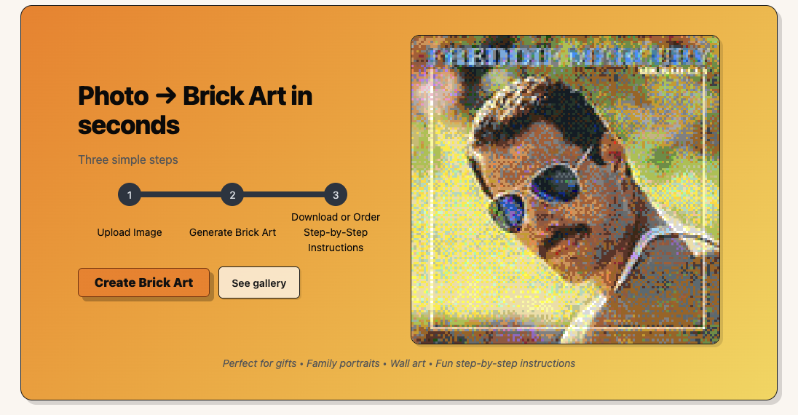
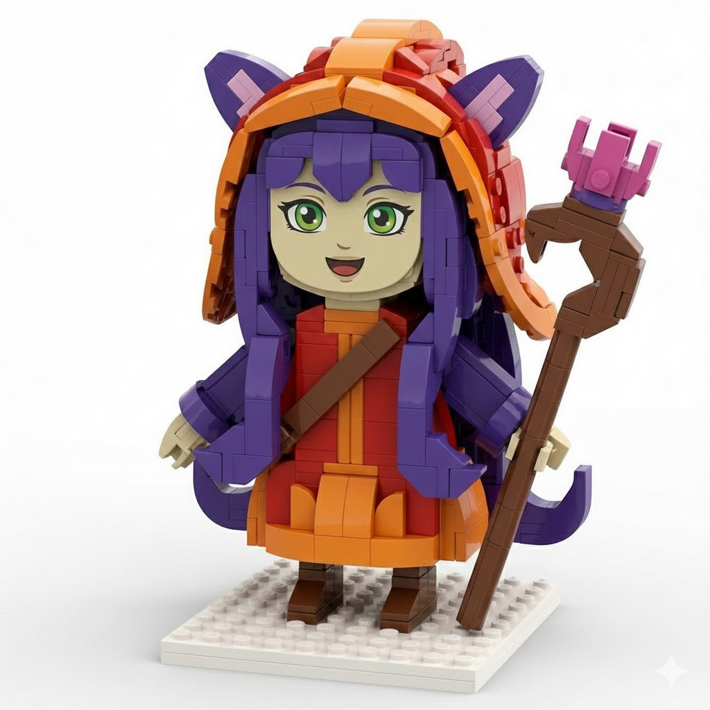
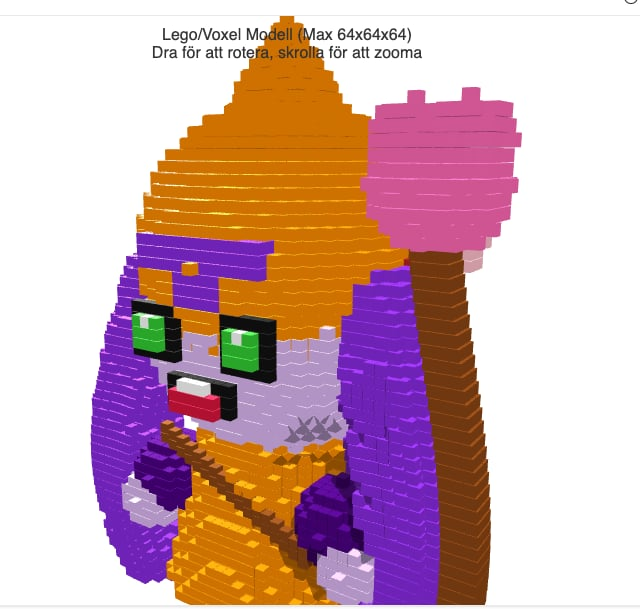
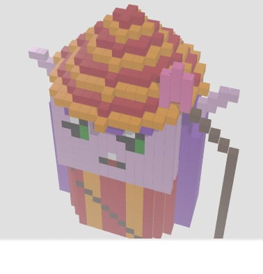
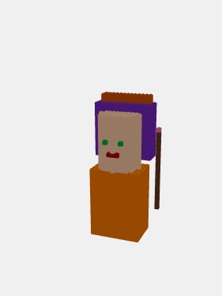
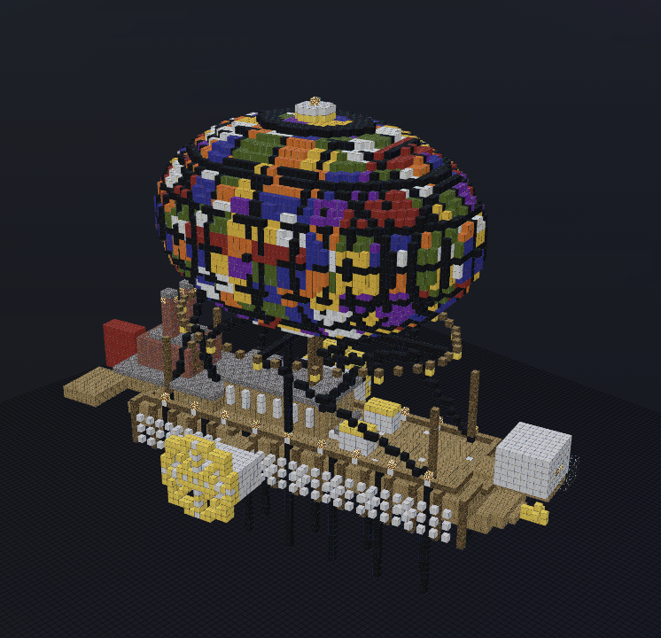

This post is not only be written by a real person but also hopefull short and to the point!

## The what

Last year I blogged about [`img2lego`](/posts/2025-01-09-img-2-lego/), now renamed `brickportraits` to remove all connection to LEGO. In my tool I make something that's not part of the LEGO franchise but can be built by any type of bricks.

Today I got a website [brickportraits.londogard.com](https://brickportrait.londogard.com/) which allows anyone to run the generation, including a 2D mode (mosaic).

## The comparison

So how good is the result? It depends on what you compare too. 

Generalist LLM's (ChatGPT and Gemini) is strong at generating images of 3D Brick Figures, but they hallucinate a lot including the available bricks! This includes the latest Nano Banana 2.

{width=30%}

Decent results, but not a fair comparison as it's not actual bricks nor is it possible to get instructions.

Moving forward I ask competitors to generate an actual 3D Figure brick by brick (ThreeJS). They break down completely, let's review!

::: {layout="[[1,1], [1,1,1]]"}

 (mine)](brickportrait_turn1.png)

:::

I'm not sure what you think, but to me the winner is as clear as day! 😉

## The how

My results are made by AI models built for 3D generation, similar to [Meshy.ai](https://www.meshy.ai/), which I voxelize and apply algorithmic enhancements to. This type of model is trained and uses optimal 3D representations internally which makes it easier to work with.

Imagine yourself writing a block by block down and reasoning about how it'll look, not easy right? It's the same for the _generalist LLM's_.  
With that said _generalist LLM's_ are capable and display good spatial ability in [MineBench](https://minebench.ai/) when generating scenes **from text**. I'm not sure if the LLM actually reason or is able to generalize from Minecraft content online but for sure each new SotA model accelerate forward!

**But!** For now this capability is really only available when generating from text, if I add a reference image it fails utterly as shared in my earlier examples. 

**What do I think personally?** Text is not as "rigid" and allows more interpretation which in turn is hallucination-friendly, which can help the model generalize from internet content to produce great results.  

# Outro

Interested to learn more or discuss something? Please reach out to me!

