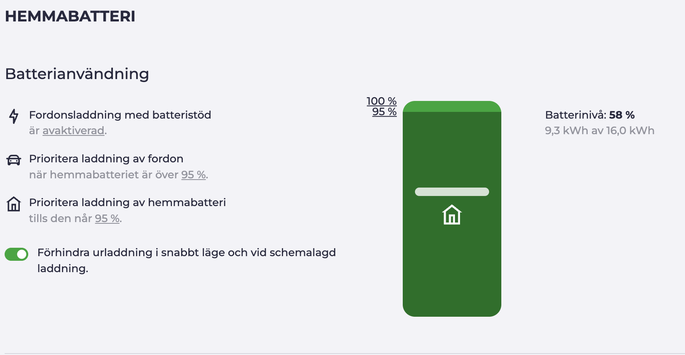
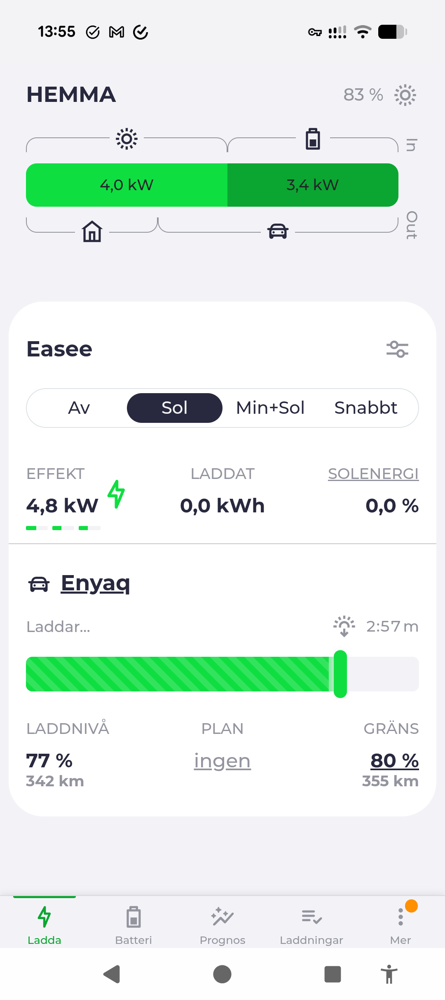

This spring me and my wife went ahead and bought a (used) EV, Skoda Enyaq iV80 2022. It's not relevant for this blog but it's a very nice car, and I do enjoy the EV "way". With that said I found myself trying to optimize the charging and our electricity provider didn't really integrate more than price optimization, I wanted to also include solar energy into that calculation.

## The problem

I'm currently on Skellefteå Kraft which doesn't really integrate more than spot-optimization on charger. The modern electricity provider Tibber doesn't yet integrate with SigenStor from SigEnergy, though it's coming (small beta right now). With that I will likely move to Tibber and deprecate the EVCC setup.

Another solution would be to buy the SigEnergy EV Charger, which would also solve my pain-points but cost me money and require replacing a functional EV Charger.

## The solution: EVCC

What I found is that [EVCC](https://evcc.io) solves all my problems and is awesome. It takes the electricity price and my solar production into account and decides when to charge:

### The setup

EVCC runs standalone on my server. For the integrations:

- **Nordpool** — electricity prices (SE4) with custom formula (add your own costs).
- **SigenStor** — solar and battery status, so the car charges on surplus solar when the sun is out.

- **Easee** — the EV charger, via cloud integration.
- **Skoda** - the EV, via cloud integration.

One thing worth noting: I don't have an `evcc.yaml` at all — EVCC only uses its `.db`. Most guides assume the yaml config, so it took me a moment to realize the setup simply lives in the database and using the UI. The `.yaml` is actually legacy now.

I drive it from both Home Assistant using the [HACS evcc integration](https://github.com/marq24/ha-evcc) and the EVCC webportal running on my Pi, which controls the local EVCC instance over its HTTP API.

And it works:

### Additional info

EVCC is great as it has many .

## What's next

When Tibber lands native SigenStor integration I might not need EVCC anymore — but for now it does exactly what I want: charge on solar when the sun is out, and on cheap electricity when it isn't.

~Hampus Londögård
