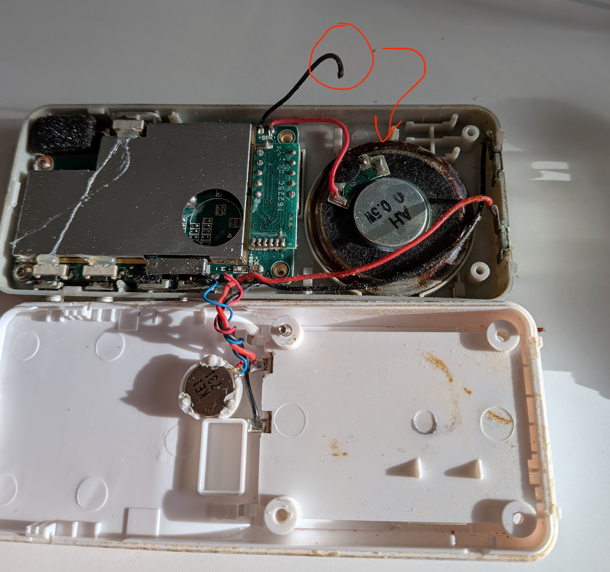

One day our baby monitor stopped producing sound. Scary with no audio from the baby's room! At least the lights still flashed whenever there was sound or movement.

Naturally I started to google new devices, hopefully cheap and good. After a good night of sleep I had the idea, what if I could repair it?

I tried to figure out exactly what was wrong. The "parent" light acknowledged whenever the "baby" microphone picked up movement or sound, so the communication was working, i.e. the "parent" device's speaker had to be broken.  
From there I was wondering, is there any shot at saving this? A chatbot suggested checking the speaker cables before I opened it, likely a wire flexing issue given the device's age (I bought it used more than 3 years ago).

Opening the device I found that one of the wires to the speaker was not soldered anymore. Easy enough!

I grabbed my soldering iron and went at it. 15 seconds later I connected the battery without assembling to test the device. Guess what? It worked!

I re-assembled the device and impressed my wife not long after.

Funny enough, a few years ago I *built* a baby monitor with video stream from scratch ([Babymonitor #1](https://blog.londogard.com/posts/2022-11-06-babymonitor-pt-1.html) and [part 2](https://blog.londogard.com/posts/2023-02-06-baby-monitor-pt-p2/)) and repairing this one took 15 seconds.

Honestly, this is not a breakthrough. It's a single solder joint, and that's the point: repair doesn't have to be impressive or hard to be effective.  
Cherry on top: it feels awesome, saves money (a new monitor is 50-100 EUR) and saves some of the planet's resources!

~Hampus Londögård
