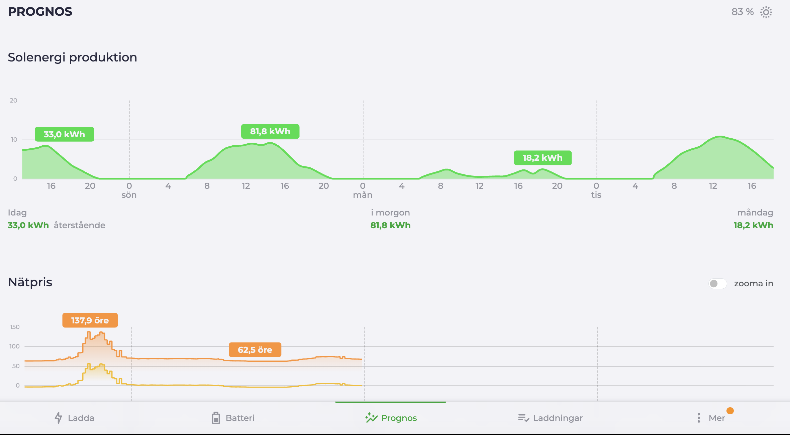

This spring my wife and I went ahead and bought a (used) EV, Skoda Enyaq iV80 2022. It's not relevant for this blog but it's a very nice car, and I do enjoy the EV "way".  
With that said I found myself trying to optimize the charging and our electricity provider didn't really integrate more than price optimization. I wished to include solar energy into the optimization engine.

## The problem

I'm currently on Skellefteå Kraft which doesn't really integrate more than spot-optimization on the charger. Tibber, the "modern" alternative, doesn't yet integrate with SigenStor from Sigenergy, though I'm told it's in beta right now. When that arrives I might simply move to Tibber and drop EVCC, KISS is the king after all.

A third solution is to go all-in Sigenergy and buy their EV Charger, super easy _but_ costly and why should I replace a functional EV Charger to begin?

## The solution: EVCC

What I found is that [EVCC](https://evcc.io) solves all my problems, and is very user friendly. It takes the electricity price, solar production, and my custom plans into account and decides when to charge:

{width="75%"}

### The setup

EVCC runs standalone, through Docker, on my Raspberry Pi. For the integrations:

- **Nordpool** — electricity prices (SE4) with custom formula (add your own costs).
- **SigenStor** — solar and battery status, so the car charges on surplus solar when the sun is out.

{width="50%"}

- **Easee** — the EV charger, via cloud integration.
- **Skoda** — the EV, via cloud integration.

One thing worth noting: I don't have an `evcc.yaml` at all — EVCC only uses its `.db`. Most guides assume the yaml config, so it took me a moment to realize the setup simply lives in the database and using the UI.

I control EVCC mainly from the EVCC web portal, but sometimes I do it from Home Assistant using the [HACS evcc integration](https://github.com/marq24/ha-evcc).

And it works cleanly:

{width="50%"}

### Additional info

I believe there are some very important parts I left out, namely:

#### Plans

You can add one or more plans, recurring or not, where you say "I need X % by Y".
These are then automatically optimized together with all available sensors and metrics.

**Arrival** is a sub-setting where you can also tell EVCC to always charge the car to X % directly as it arrives.

#### Battery

**Battery Boost:** lets EVCC draw on the home battery to charge the car beyond pure solar surplus (handy right before a departure). It's enabled per charging session, with a configurable limit for how far the battery may be drained. I keep this blocked to allow SigEnergy to optimize it's AI better.

**Battery Prioritization:** you can choose which gets priority — battery over car, or the reverse.

#### Spot Price

There are additional tweaks to add, such as "don't charge when export price is above X SEK, then rather export energy to earn money". And the reversed option, import energy when it's cheap enough to charge the car.

#### Mode

EVCC has 4 modes, "Off"/"Solar"/"Min+Solar"/"Fast", which control how aggressively the car is charged. I use "Solar" which means that unless a Plan is active it'll only charge using Solar excess power, when price is under my defined SEK limit.

### Final words

EVCC is great, I highly recommend it to anyone on the fence.

~Hampus Londögård
